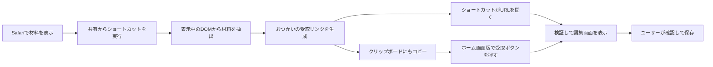

# Safari共有からの自動取込

2026-10-15。無料・広告なし・サーバー不要・CORS/アクセス制限を回避しない条件で、**Safariの共有を開始点にした材料抽出と確認画面への受渡し**を実装した。

クックパッドのURLをPWAへ入力するだけで取得する方式は、引き続き未対応。確認したページにはCORS許可がなく、一般利用できる公式のCORS対応材料APIも今回の調査では確認できなかった。別サーバーに取得させるプロキシ、非公開API、ネイティブHTTP取得への置換は追加していない。

## 自動化する範囲

コードはユーザーがSafariで開いたページ上で実行する。自動巡回・バックグラウンド取得は行わず、ページのログイン・有料表示・閲覧制限を解除しない。読み取るのは表示された材料欄・料理名・人数・著者・出典・URLだけ。通信、Cookie読取、ページ変更を行わない。作り方と写真は受け渡さない。

## 初回設定と普段の操作

1. おつかい → レシピ → レシピを取り込む → ページ取込 →「初回だけ：ショートカットの作り方」を開く。
2. 「確認画面を自動で開く」を選び、実行用JavaScriptをコピーする。
3. iPhoneのショートカットで「おつかいに取り込む」を新規作成する。共有シートに表示し、入力を「SafariのWebページ」にする。
4. 「WebページでJavaScriptを実行」を追加する。入力はショートカットの入力。既定コード全体を手順2のコードに置き換える。
5. 「クリップボードにコピー」を追加し、内容はJavaScriptの実行結果にする。
6. 「URLを開く」を追加し、開くURLもJavaScriptの実行結果にする。

以後は、Safariでレシピの材料を表示 → 共有 →「おつかいに取り込む」。ショートカットが受取URLを開き、おつかいが自動解析して確認画面を表示する。JSONの選択・コピー・手動解析は不要。保存はユーザー操作のまま。

元ページの入力にURL文字列だけを渡しても、SafariのWebページとしてJavaScriptを実行できない。設定・実行許可は[Apple公式のJavaScript実行手順](https://support.apple.com/ja-jp/guide/shortcuts/apdb71a01d93/ios)に従う。作成済みショートカットの自動インストールは提供していない。

### ホーム画面版を普段使う場合

URLを開く操作でホーム画面版が起動するとは仮定しない。Safariとホーム画面版の保存領域が分かれる場合があるため、受取画面に保存先を明示する。普段のホーム画面版へ戻り、「レシピ」→「共有した材料を取り込む」を押すと、その保存領域で検証・編集画面を開く。ショートカットはリンクをクリップボードにもコピーしているので、材料JSONを手動で選ぶ必要はない。

Safariを自動で開かせたくない場合は、初回設定で「ホーム画面版へコピー」を選ぶ。このコードは従来と互換のJSONを返す。ショートカットには手順6の「URLを開く」を追加しない。旧ショートカットのJSONも、同じ受取ボタンで引き続き使える。

クリップボードはユーザーが受取ボタンを押したときだけ読む。起動時・復帰時・定期ポーリングでは読まない。iOSは追加の貼付操作を求める場合がある。許可されない場合はページ取込欄へ長押しで貼り付けると自動解析する。[WebKitのClipboard仕様](https://webkit.org/blog/10855/async-clipboard-api/)に従い、OSの許可を回避しない。

## 実装と境界

- `services/page-capture.ts`: 元ページ用の自己完結コードを生成する。自動方式は、共通のエンコーダーもコードへ組み込み、結果を`completion`で1回返す。実行結果を開くのはユーザーが構成したショートカット。
- `services/import-handoff.ts`: `#otsukai-import=v1.<base64url>`でUTF-8の材料JSONを渡す。queryには材料を置かず、fragmentはHTTP要求へ送られない。受信するorigin/pathは現在のおつかいと完全一致させ、認証情報・query・未知の版・壊れたデータを拒否する。
- `main.tsx`/`App.tsx`: 起動時またはhash変更時に受信し、解析前に`history.replaceState`でfragmentを消す。通常のURLや既存hashは変更しない。開いている入力があれば、別の受信で上書きせず確認待ちにする。
- `RecipeImport`: `parsePageCapture`と既存のZod検証を通して編集画面へ渡す。受信だけではDBへ保存しない。既存食材のカテゴリは現在の設定を優先する。
- `RecipesPage`/`PageCaptureHelp`: リンクと旧JSONの双方を受け取り、貼付と解析をまとめる。

自動受取URLはアプリ側で16,000文字までに制限する。iOSのすべての版でこの長さの受渡しを保証するものではない。上限を超えた場合は`IMP-4007`を返し、100KBまでのJSONコピー方式へ案内する。不正なリンクは`IMP-4006`。元ページの材料欠落などは従来のコードを保持する。

受取リンクには材料が含まれる。他者へのリンク共有、ブラウザの履歴同期、OSのクリップボード同期はその環境の設定に従う。アプリは受信後にアドレスから材料を取り除き、診断・ログ・バックアップへ受取URLを残さない。レシピに保存するURLは元のクックパッドURL。

DB/バックアップはv2のまま。依存パッケージ、外部サービス、アカウント登録、認証トークンは追加していない。

## 検証範囲

本番ビルドの生成コードをブラウザ上の元ページで実行し、リンク生成→おつかいの自動受信→確認→保存をテストする。オフライン受信、材料のHTTP送信がないこと、キャンセルで未保存、壊れたリンク/元ページ/上限、編集中の受信、旧JSON互換、クリップボード未対応と手動貼付も検証する。

iOS実機のショートカット作成・共有・実行許可・URLを開く・貼付許可・ホーム画面への切替は、この環境では未検証。自動化できるWeb側の処理と実機のOS操作を区別する。次の確認は、実機で初回設定後に指定レシピから取り込み、普段の保存領域へ保存できること。
